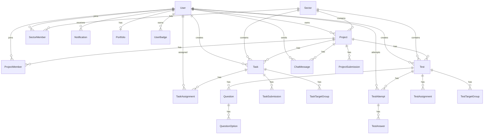
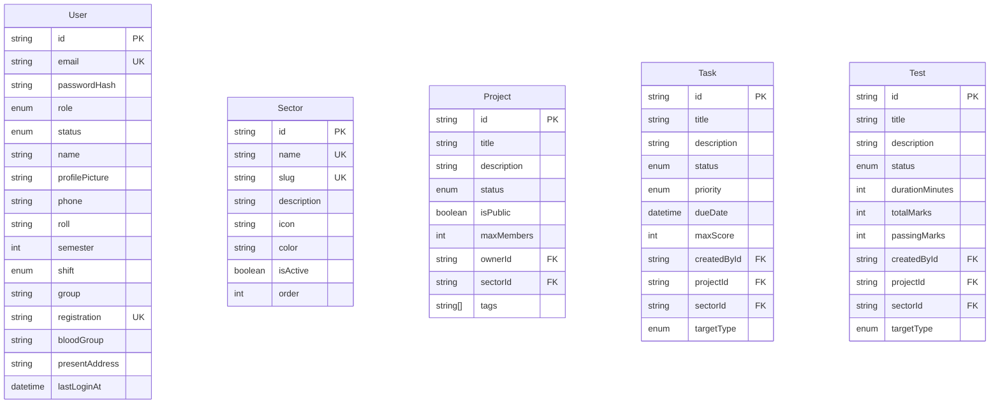
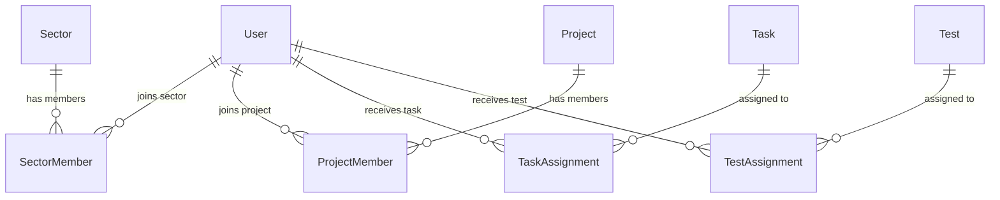
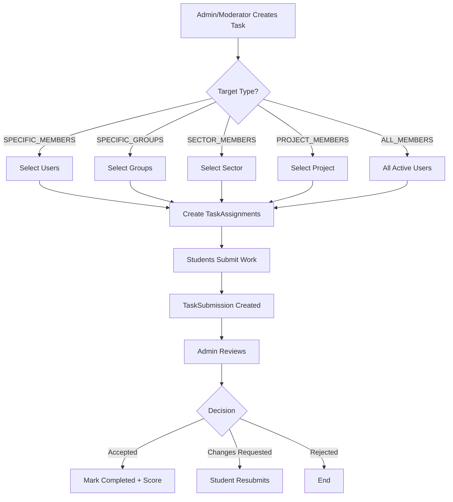
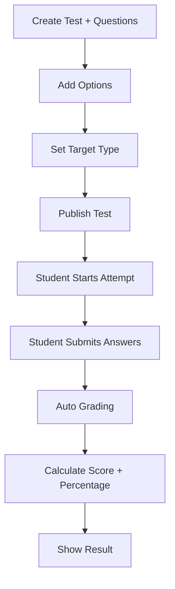
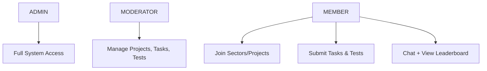

# Programming Club Management System

A modern, scalable backend for college programming clubs with **Sectors**, **Project Rooms**, **Tasks**, **MCQ Tests**, **Real-time Chat**, and **Analytics**.

## Tech Stack

- **Runtime**: Node.js + TypeScript
- **Framework**: Fastify 5
- **Database**: PostgreSQL + Prisma
- **Auth**: JWT + HTTP-only Cookies
- **Real-time**: Socket.io
- **File Upload**: Cloudinary
- **Queue**: BullMQ + Redis

---

## Database Schema Overview

### High Level Architecture



---

### Core Entities



---

### Membership & Assignment Flow



---

### Task & Submission Flow



---

### Test (MCQ) Flow



---

## Modules Overview

| Module          | Prefix                    | Description                              |
|-----------------|---------------------------|------------------------------------------|
| Auth            | `/api/v1/auth`            | Login, Logout, Refresh, Change Password  |
| User            | `/api/v1/users`           | CRUD + Profile Picture                   |
| Sector          | `/api/v1/sectors`         | Web Dev, App Dev, Cyber Security etc.    |
| Project         | `/api/v1/projects`        | Project Rooms + Contribution Requests    |
| Task            | `/api/v1/tasks`           | Flexible Task Assignment                 |
| Test            | `/api/v1/tests`           | MCQ System with Auto Grading             |
| Submission      | `/api/v1/submissions`     | Task & Project Submissions               |
| Chat            | `/api/v1/chat`            | Real-time Project Chat (Socket.io)       |
| Notification    | `/api/v1/notifications`   | In-app Notifications                     |
| Analytics       | `/api/v1/analytics`       | Dashboard, Leaderboard, Sector Stats     |

---

## Role Hierarchy



---

## Key Features

- **Multi-Sector Support** (Web, App, Cyber, AI, CP...)
- **Flexible Task Targeting** (Members / Groups / Sector / Project / All)
- **Real-time Chat** per Project Room
- **MCQ System** with auto grading
- **Contribution Request** workflow
- **Leaderboard & Badges**
- **Analytics Dashboard**
- **Notification System**

---


## API Documentation

**Base URL:** `http://localhost:5000/api/v1`

> All protected routes require authentication via HTTP-only cookies (`accessToken`).

---

### 1. Auth APIs

| Method | Endpoint                  | Auth     | Description                |
|--------|---------------------------|----------|----------------------------|
| POST   | `/auth/login`             | Public   | Login                      |
| POST   | `/auth/refresh-token`     | Public   | Refresh access token       |
| POST   | `/auth/logout`            | Public   | Logout                     |
| POST   | `/auth/change-password`   | Private  | Change password            |
| GET    | `/auth/me`                | Private  | Get current user profile   |

#### Login
```http
POST /auth/login
Content-Type: application/json

{
  "email": "jabed1780@gmail.com",
  "password": "Admin@123"
}
```

#### Change Password
```http
POST /auth/change-password
Content-Type: application/json

{
  "oldPassword": "Admin@123",
  "newPassword": "NewPassword@123"
}
```

---

### 2. User APIs

| Method | Endpoint          | Auth              | Description              |
|--------|-------------------|-------------------|--------------------------|
| POST   | `/users`          | Admin, Moderator  | Create user              |
| GET    | `/users`          | Admin, Moderator  | Get all users (filter)   |
| GET    | `/users/:id`      | All roles         | Get single user          |
| PATCH  | `/users/:id`      | Admin, Moderator  | Update user              |
| DELETE | `/users/:id`      | Admin             | Soft delete user         |

#### Create User
```http
POST /users
Content-Type: application/json

{
  "email": "member1@example.com",
  "password": "Member@123",
  "name": "Rakib Hasan",
  "role": "MEMBER",
  "phone": "01711112222",
  "roll": "210101",
  "semester": 5,
  "shift": "DAY",
  "group": "A",
  "registration": "REG-210101",
  "bloodGroup": "B+",
  "presentAddress": "Dhaka, Bangladesh"
}
```

#### Get All Users (with filters)
```http
GET /users?page=1&limit=10&searchTerm=rakib&role=MEMBER&status=ACTIVE&semester=5&shift=DAY&group=A&sortBy=createdAt&sortOrder=desc
```

---

### 3. Sector APIs

| Method | Endpoint                | Auth              | Description              |
|--------|-------------------------|-------------------|--------------------------|
| POST   | `/sectors`              | Admin             | Create sector            |
| GET    | `/sectors`              | Public            | Get all sectors          |
| GET    | `/sectors/:id`          | Public            | Get single sector        |
| PATCH  | `/sectors/:id`          | Admin             | Update sector            |
| DELETE | `/sectors/:id`          | Admin             | Delete sector            |
| POST   | `/sectors/:id/join`     | All roles         | Join sector              |
| DELETE | `/sectors/:id/leave`    | All roles         | Leave sector             |
| GET    | `/sectors/:id/members`  | All roles         | Get sector members       |

#### Create Sector
```http
POST /sectors
Content-Type: application/json

{
  "name": "Web Development",
  "slug": "web-development",
  "description": "Frontend & Backend web technologies",
  "icon": "globe",
  "color": "#3B82F6",
  "order": 1
}
```

---

### 4. Project APIs

| Method | Endpoint                              | Auth      | Description                    |
|--------|---------------------------------------|-----------|--------------------------------|
| POST   | `/projects`                           | All roles | Create project room            |
| GET    | `/projects`                           | Public    | Get all projects               |
| GET    | `/projects/:id`                       | Public    | Get single project             |
| PATCH  | `/projects/:id`                       | Owner     | Update project                 |
| DELETE | `/projects/:id`                       | Owner     | Delete project                 |
| POST   | `/projects/:id/request`               | All roles | Request to join project        |
| PATCH  | `/projects/:projectId/members/:memberId` | Owner  | Accept / Reject request        |

#### Create Project
```http
POST /projects
Content-Type: application/json

{
  "title": "E-Commerce Platform",
  "description": "Full stack e-commerce using Next.js",
  "isPublic": true,
  "maxMembers": 6,
  "tags": ["nextjs", "prisma", "tailwind"],
  "sectorId": "sector_id_here"
}
```

#### Accept / Reject Contribution
```http
PATCH /projects/:projectId/members/:memberId
Content-Type: application/json

{
  "status": "ACTIVE"   // or "REJECTED"
}
```

---

### 5. Task APIs

| Method | Endpoint       | Auth              | Description          |
|--------|----------------|-------------------|----------------------|
| POST   | `/tasks`       | Admin, Moderator  | Create task          |
| GET    | `/tasks`       | All roles         | Get all tasks        |
| GET    | `/tasks/:id`   | All roles         | Get single task      |
| PATCH  | `/tasks/:id`   | Creator           | Update task          |
| DELETE | `/tasks/:id`   | Creator           | Delete task          |

#### Create Task
```http
POST /tasks
Content-Type: application/json

{
  "title": "Build Login Page",
  "description": "Create responsive login UI",
  "priority": "HIGH",
  "dueDate": "2026-10-20T23:59:59.000Z",
  "maxScore": 10,
  "sectorId": "sector_id_here",
  "projectId": "project_id_here",
  "targetType": "SECTOR_MEMBERS",
  "memberIds": [],
  "groups": []
}
```

**Possible `targetType` values:**
- `ALL_MEMBERS`
- `SPECIFIC_MEMBERS` (+ `memberIds`)
- `SPECIFIC_GROUPS` (+ `groups`)
- `PROJECT_MEMBERS` (+ `projectId`)
- `SECTOR_MEMBERS` (+ `sectorId`)

---

### 6. Test (MCQ) APIs

| Method | Endpoint                  | Auth              | Description              |
|--------|---------------------------|-------------------|--------------------------|
| POST   | `/tests`                  | Admin, Moderator  | Create test              |
| GET    | `/tests`                  | All roles         | Get all tests            |
| GET    | `/tests/:id`              | All roles         | Get single test          |
| PATCH  | `/tests/:id`              | Creator           | Update test              |
| PATCH  | `/tests/:id/publish`      | Creator           | Publish test             |
| DELETE | `/tests/:id`              | Creator           | Delete test              |
| POST   | `/tests/:id/start`        | All roles         | Start attempt            |
| POST   | `/tests/:id/submit`       | All roles         | Submit answers           |
| GET    | `/tests/:id/my-attempt`   | All roles         | Get my attempt result    |

#### Create Test
```http
POST /tests
Content-Type: application/json

{
  "title": "JavaScript Basics Quiz",
  "description": "Test your JS fundamentals",
  "durationMinutes": 30,
  "passingMarks": 6,
  "sectorId": "sector_id_here",
  "targetType": "SECTOR_MEMBERS",
  "questions": [
    {
      "questionText": "What is the output of typeof null?",
      "type": "SINGLE_CHOICE",
      "marks": 2,
      "explanation": "typeof null returns 'object' (historical bug)",
      "options": [
        { "optionText": "null", "isCorrect": false },
        { "optionText": "object", "isCorrect": true },
        { "optionText": "undefined", "isCorrect": false },
        { "optionText": "number", "isCorrect": false }
      ]
    }
  ]
}
```

#### Submit Attempt
```http
POST /tests/:id/submit
Content-Type: application/json

{
  "answers": [
    {
      "questionId": "question_id_here",
      "selectedOptionIds": ["option_id_here"]
    }
  ]
}
```

---

### 7. Submission APIs

| Method | Endpoint                              | Auth              | Description                  |
|--------|---------------------------------------|-------------------|------------------------------|
| POST   | `/submissions/tasks/:taskId`          | All roles         | Submit task                  |
| GET    | `/submissions/tasks/:taskId`          | Admin, Moderator  | Get task submissions         |
| PATCH  | `/submissions/tasks/review/:id`       | Admin, Moderator  | Review task submission       |
| POST   | `/submissions/projects/:projectId`    | All roles         | Submit project               |
| PATCH  | `/submissions/projects/review/:id`    | Owner             | Review project submission    |

#### Submit Task
```http
POST /submissions/tasks/:taskId
Content-Type: application/json

{
  "content": "I completed the login page",
  "link": "https://github.com/user/repo",
  "fileUrls": []
}
```

#### Review Submission
```http
PATCH /submissions/tasks/review/:submissionId
Content-Type: application/json

{
  "status": "ACCEPTED",
  "score": 9,
  "feedback": "Great work! Just fix the mobile responsiveness."
}
```

---

### 8. Chat APIs

| Method | Endpoint                        | Auth      | Description              |
|--------|---------------------------------|-----------|--------------------------|
| GET    | `/chat/:projectId/messages`     | Member    | Get project messages     |
| POST   | `/chat/:projectId/messages`     | Member    | Send message             |
| DELETE | `/chat/messages/:messageId`     | Sender    | Delete own message       |

#### Send Message
```http
POST /chat/:projectId/messages
Content-Type: application/json

{
  "content": "Hello team! Let's start working.",
  "replyToId": null
}
```

#### Socket.io Events
```js
// Join project room
socket.emit("join_project", projectId);

// Send message
socket.emit("send_message", {
  projectId,
  content: "Hello!",
  tokenUserId: currentUserId
});

// Listen for new messages
socket.on("new_message", (message) => {
  console.log(message);
});

// Typing indicator
socket.emit("typing", { projectId, userName: "Rakib" });
socket.on("user_typing", (data) => {
  console.log(data.userName + " is typing...");
});
```

---

### 9. Notification APIs

| Method | Endpoint                      | Auth      | Description                |
|--------|-------------------------------|-----------|----------------------------|
| GET    | `/notifications`              | Private   | Get my notifications       |
| GET    | `/notifications/unread-count` | Private   | Get unread count           |
| PATCH  | `/notifications/:id/read`     | Private   | Mark as read               |
| PATCH  | `/notifications/read-all`     | Private   | Mark all as read           |
| DELETE | `/notifications/:id`          | Private   | Delete notification        |

```http
GET /notifications?page=1&limit=20&isRead=false
```

---

### 10. Analytics APIs

| Method | Endpoint                        | Auth              | Description                |
|--------|---------------------------------|-------------------|----------------------------|
| GET    | `/analytics/dashboard`          | Admin, Moderator  | Overall stats              |
| GET    | `/analytics/recent-activities`  | Admin, Moderator  | Recent activities          |
| GET    | `/analytics/leaderboard`        | All roles         | User leaderboard           |
| GET    | `/analytics/projects`           | Admin, Moderator  | Project stats              |
| GET    | `/analytics/sectors`            | Admin, Moderator  | Sector stats               |
| GET    | `/analytics/growth`             | Admin             | Monthly user growth        |

---

## Common Query Parameters

| Parameter     | Type     | Default     | Description                  |
|---------------|----------|-------------|------------------------------|
| `page`        | number   | 1           | Page number                  |
| `limit`       | number   | 10          | Items per page (max 100)     |
| `sortBy`      | string   | createdAt   | Field to sort by             |
| `sortOrder`   | string   | desc        | `asc` or `desc`              |
| `searchTerm`  | string   | -           | Search keyword               |

---

## Standard Response Format

```json
{
  "success": true,
  "message": "Operation successful",
  "meta": {
    "page": 1,
    "limit": 10,
    "total": 45,
    "totalPages": 5,
    "hasNextPage": true,
    "hasPrevPage": false
  },
  "data": {}
}
```

## Error Response Format

```json
{
  "success": false,
  "message": "Error message here"
}
```

## Getting Started

```bash
# Install dependencies
pnpm install

# Setup environment
cp .env.example .env

# Generate Prisma Client
pnpm db:generate

# Run migrations
pnpm db:migrate

# Seed admin + default sectors
pnpm db:seed

# Start development server
pnpm dev
```

---

## License

MIT