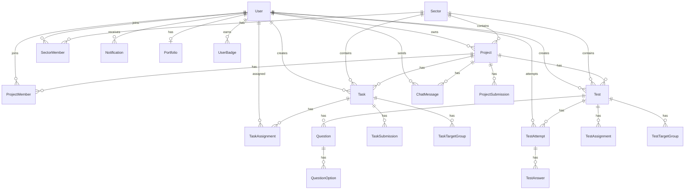
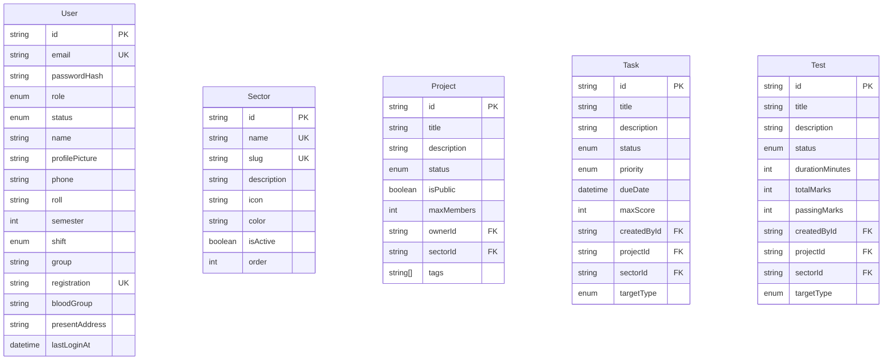
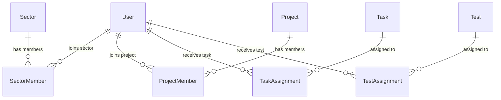
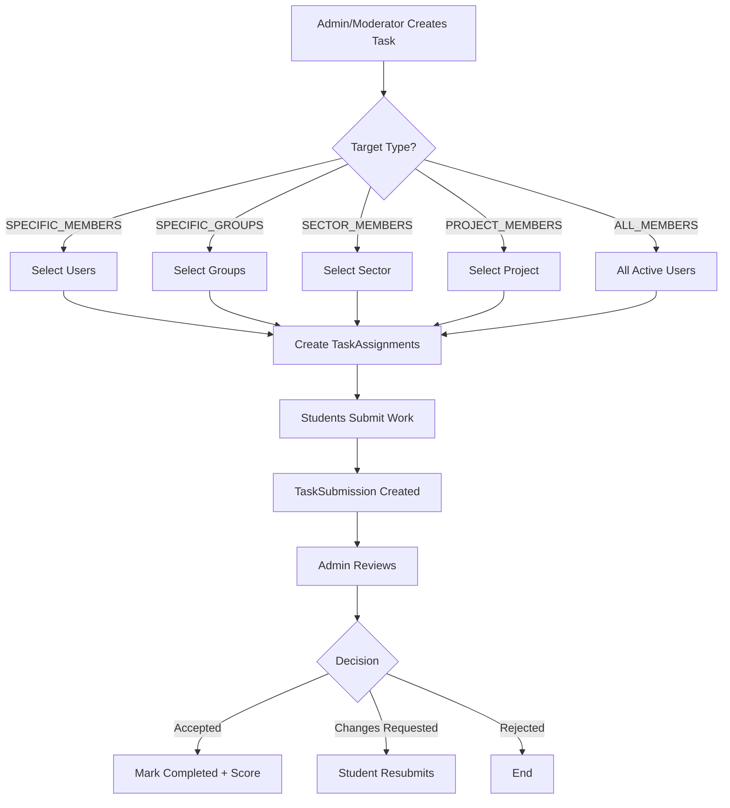
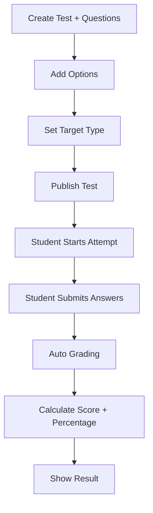
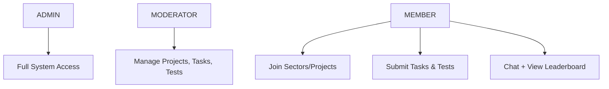

# Programming Club Management System

A modern, scalable backend for college programming clubs with **Sectors**, **Project Rooms**, **Tasks**, **MCQ Tests**, **Real-time Chat**, and **Analytics**.

## Tech Stack

- **Runtime**: Node.js + TypeScript
- **Framework**: Fastify 5
- **Database**: PostgreSQL + Prisma
- **Auth**: JWT + HTTP-only Cookies
- **Real-time**: Socket.io
- **File Upload**: Cloudinary
- **Queue**: BullMQ + Redis

---

## Database Schema Overview

### High Level Architecture



---

### Core Entities



---

### Membership & Assignment Flow



---

### Task & Submission Flow



---

### Test (MCQ) Flow



---

## Modules Overview

| Module          | Prefix                    | Description                              |
|-----------------|---------------------------|------------------------------------------|
| Auth            | `/api/v1/auth`            | Login, Logout, Refresh, Change Password  |
| User            | `/api/v1/users`           | CRUD + Profile Picture                   |
| Sector          | `/api/v1/sectors`         | Web Dev, App Dev, Cyber Security etc.    |
| Project         | `/api/v1/projects`        | Project Rooms + Contribution Requests    |
| Task            | `/api/v1/tasks`           | Flexible Task Assignment                 |
| Test            | `/api/v1/tests`           | MCQ System with Auto Grading             |
| Submission      | `/api/v1/submissions`     | Task & Project Submissions               |
| Chat            | `/api/v1/chat`            | Real-time Project Chat (Socket.io)       |
| Notification    | `/api/v1/notifications`   | In-app Notifications                     |
| Analytics       | `/api/v1/analytics`       | Dashboard, Leaderboard, Sector Stats     |

---

## Role Hierarchy



---

## Key Features

- **Multi-Sector Support** (Web, App, Cyber, AI, CP...)
- **Flexible Task Targeting** (Members / Groups / Sector / Project / All)
- **Real-time Chat** per Project Room
- **MCQ System** with auto grading
- **Contribution Request** workflow
- **Leaderboard & Badges**
- **Analytics Dashboard**
- **Notification System**

---

## Getting Started

```bash
# Install dependencies
pnpm install

# Setup environment
cp .env.example .env

# Generate Prisma Client
pnpm db:generate

# Run migrations
pnpm db:migrate

# Seed admin + default sectors
pnpm db:seed

# Start development server
pnpm dev
```

---

## License

MIT